# 基于springboot的公益服务平台的设计与实现

> 🎓 **计算机毕业设计 · 基于springboot的公益服务平台的设计与实现**
>
> 本仓库只放**项目介绍 + 运行截图**（截图是站点带水印的原图，存在仓库 `images/` 里）。
>
> 👉 **完整可运行源码 / 数据库脚本 / 部署文档：[点我获取](https://geekcode.top/archives/%E5%9F%BA%E4%BA%8Espringboot%E7%9A%84%E5%85%AC%E7%9B%8A%E6%9C%8D%E5%8A%A1%E5%B9%B3%E5%8F%B0%E7%9A%84%E8%AE%BE%E8%AE%A1%E4%B8%8E%E5%AE%9E%E7%8E%B0?utm_source=github)**
>
> 💬 咨询微信：**ir9372**　|　🌐 更多项目：[极客代码 geekcode.top](https://geekcode.top/?utm_source=github)
>
> 📌 项目详情页：<https://geekcode.top/archives/%E5%9F%BA%E4%BA%8Espringboot%E7%9A%84%E5%85%AC%E7%9B%8A%E6%9C%8D%E5%8A%A1%E5%B9%B3%E5%8F%B0%E7%9A%84%E8%AE%BE%E8%AE%A1%E4%B8%8E%E5%AE%9E%E7%8E%B0?utm_source=github>

<table><td width="230" align="center"> <b>扫码加微信 ir9372</b></td><td valign="middle">📦 源码 = 项目介绍 + 全部运行截图 + 数据库 + 部署文档 👉 点上方任意截图，直接跳到 <b>极客代码 geekcode.top</b> 详情页</td></table>

---

<h1>基于springboot的公益服务平台的设计与实现</h1>
<h2>项目概述</h2>

本项目旨在构建一个基于 Spring Boot 与 Vue 前后端分离架构的公益服务平台，以解决传统公益活动信息分散、报名流程繁琐及志愿者管理效率低下的问题。平台核心功能涵盖活动信息发布与管理、在线报名与取消、志愿者申请审核、公益新闻宣传以及用户互动留言等模块。系统采用 Shiro 进行权限控制，MyBatis-Plus 实现数据持久化，确保了系统的安全性与开发效率。适用人群包括普通公众（参与者）、志愿者及后台管理员。通过数字化手段整合公益资源，提升服务透明度与用户体验，适用于社区、高校或社会组织的公益性质的线上服务平台建设。

<h2>技术架构</h2>

本项目采用经典的前后端分离架构设计，具体技术选型如下：

<strong>1. 后端架构</strong>

<ul>
<li><strong>核心框架</strong>：Spring Boot，利用其自动配置特性快速搭建应用骨架，简化部署流程。</li>
<li><strong>ORM 层</strong>：MyBatis-Plus，在 MyBatis 基础上增强 CRUD 操作能力，减少重复代码，提高数据库交互效率。</li>
<li><strong>安全框架</strong>：Apache Shiro，用于身份认证、授权管理及会话控制，保障系统访问安全。</li>
<li><strong>数据库连接</strong>：MySQL Connector/J，配合 Spring JDBC 实现数据持久化存储。</li>
</ul>

<strong>2. 前端架构</strong>

<ul>
<li><strong>视图层</strong>：Vue.js，构建响应式单页应用（SPA），提供流畅的用户交互体验。</li>
<li><strong>通信机制</strong>：通过 RESTful API 与后端进行 JSON 数据交换。</li>
</ul>

<strong>3. 数据库设计要点</strong>

<ul>
<li>主要实体表包括：活动信息表、活动报名表、志愿者申请表、用户表、公益新闻表、留言板表、收藏记录表、评论表及系统配置表。</li>
<li>设计遵循第三范式，确保数据冗余最小化，同时通过外键关联维护业务逻辑的一致性。</li>
</ul>

<a href="https://geekcode.top/archives/%E5%9F%BA%E4%BA%8Espringboot%E7%9A%84%E5%85%AC%E7%9B%8A%E6%9C%8D%E5%8A%A1%E5%B9%B3%E5%8F%B0%E7%9A%84%E8%AE%BE%E8%AE%A1%E4%B8%8E%E5%AE%9E%E7%8E%B0?utm_source=github" title="查看完整源码">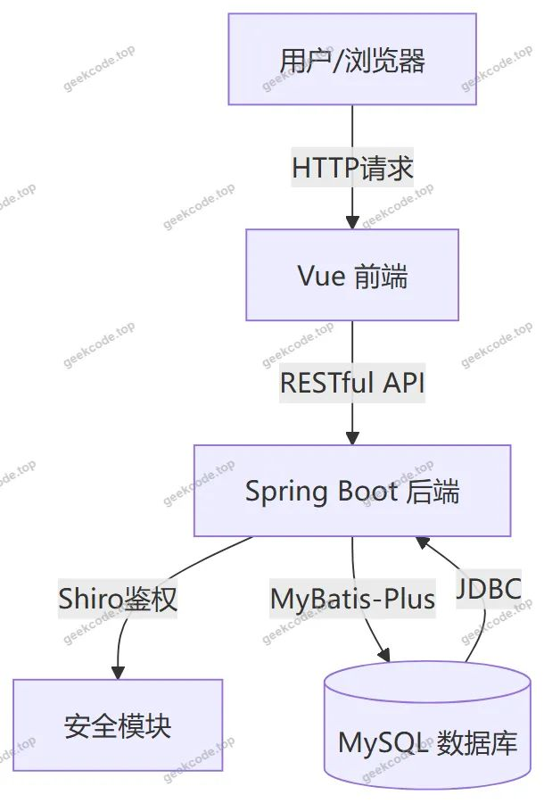</a>

<h2>功能模块</h2>

根据源码控制器及路由配置，系统功能划分为前台用户端和后台管理端两大部分。

<h3>前台用户端</h3>

前台界面简洁直观，主要面向普通用户提供公益参与入口。

<ul>
<li><strong>首页展示</strong>：聚合轮播图、最新活动及公告信息，作为流量入口。</li>
<li><strong>活动信息管理</strong>：浏览“活动信息”列表，查看活动详情；支持对感兴趣的活动进行“收藏”。</li>
<li><strong>活动报名与取消</strong>：用户可提交“活动报名”，并在个人中心或列表页执行“取消报名”操作。</li>
<li><strong>志愿者申请</strong>：提供“申请志愿者”入口，允许用户提交个人资料成为注册志愿者。</li>
<li><strong>公益新闻阅读</strong>：浏览“公益新闻”栏目，获取最新的公益动态与资讯。</li>
<li><strong>互动交流</strong>：</li>
<li><strong>留言板</strong>：用户可在“留言板”发表意见或咨询。</li>
<li><strong>活动评论</strong>：针对特定活动发表“活动信息评论”，形成社区反馈闭环。</li>
<li><strong>个人中心</strong>：查看个人信息、我的报名记录、我的收藏列表及申请的志愿者状态。</li>
<li><strong>关于我们</strong>：展示平台简介及联系方式。</li>
</ul>
<h3>后台管理端</h3>

后台为管理员提供全面的数据管理与系统配置功能。

<ul>
<li><strong>系统登录与安全</strong>：管理员登录验证，集成 Shiro 权限控制。</li>
<li><strong>内容管理</strong>：</li>
<li><strong>公益新闻管理</strong>：发布、编辑、删除新闻文章。</li>
<li><strong>活动信息管理</strong>：创建和维护公益活动详情，包括时间、地点、人数限制等。</li>
<li><strong>关于我们/系统简介</strong>：编辑平台介绍文本及图片。</li>
<li><strong>轮播图管理</strong>：配置首页展示的图片素材。</li>
<li><strong>业务数据处理</strong>：</li>
<li><strong>活动报名管理</strong>：查看、审核所有用户的报名记录。</li>
<li><strong>取消报名管理</strong>：处理用户的取消报名请求，更新活动剩余名额。</li>
<li><strong>志愿者管理</strong>：审核“申请志愿者”的用户资料，维护“志愿者”名单。</li>
<li><strong>评论管理</strong>：监控并管理用户对活动的评论内容。</li>
<li><strong>留言管理</strong>：回复或删除用户在“留言板”发布的消息。</li>
<li><strong>用户管理</strong>：管理系统注册用户账号，重置密码或禁用异常账户。</li>
<li><strong>系统配置</strong>：修改网站名称、版权信息等全局参数。</li>
</ul>
<h2>用户角色与权限</h2>

基于 Shiro 框架及业务逻辑，系统主要存在两类角色：普通用户和管理员。

<strong>1. 普通用户 (User)</strong>

<ul>
<li><strong>权限范围</strong>：仅限前台操作及个人数据查看。</li>
<li><strong>具体功能</strong>：</li>
<li>浏览首页、活动信息、公益新闻、关于我们、留言板。</li>
<li>执行活动报名、取消报名操作。</li>
<li>提交志愿者申请。</li>
<li>对活动进行评论、收藏。</li>
<li>在个人中心查看自己的报名记录、收藏列表及志愿者申请状态。</li>
<li><em>注：根据现有代码结构，未明确区分“游客”与“注册用户”的不同浏览权限，通常需登录后方可进行报名、评论、收藏等写操作。</em></li>
</ul>

<strong>2. 管理员 (Admin)</strong>

<ul>
<li><strong>权限范围</strong>：拥有后台全量管理权限，可进行增删改查及系统配置。</li>
<li><strong>具体功能</strong>：</li>
<li><strong>基础设置</strong>：登录后台、修改系统简介、关于我们、轮播图、网站配置。</li>
<li><strong>内容运营</strong>：发布和管理公益新闻、活动信息。</li>
<li><strong>业务审批</strong>：审核活动报名、处理取消报名、审核志愿者申请、管理志愿者档案。</li>
<li><strong>互动监管</strong>：管理活动评论、回复留言板内容。</li>
<li><strong>用户治理</strong>：查看和管理所有注册用户信息。</li>
</ul>
<h2>项目特色与创新点</h2>
<ol>
<li><strong>全流程数字化公益闭环</strong>：实现了从“信息发布 -&gt; 用户浏览 -&gt; 在线报名/申请 -&gt; 后台审核 -&gt; 结果反馈”的完整业务链路，消除了纸质登记或线下沟通的低效环节。</li>
<li><strong>灵活的志愿者管理体系</strong>：不仅支持普通用户参与活动，还专门设计了“申请志愿者”与“志愿者管理”模块，便于平台筛选和管理核心服务人员，提升了公益活动的组织专业性。</li>
<li><strong>强交互性的社区氛围</strong>：集成了“留言板”与“活动评论”双轨制互动功能，既允许用户对平台整体提出建议，也支持针对具体活动进行即时反馈，增强了用户粘性和平台透明度。</li>
<li><strong>高安全性与规范性</strong>：引入 Apache Shiro 进行细粒度的权限控制，防止越权访问；使用 MyBatis-Plus 规范数据访问层，提升了系统的可维护性和扩展性。</li>
</ol>
<h2>部署环境</h2>

为确保项目正常运行，需准备以下软硬件环境：

<strong>1. 硬件环境</strong>

<ul>
<li>CPU: Intel Core i5 及以上</li>
<li>内存: 8GB RAM 及以上</li>
<li>硬盘: SSD 20GB 可用空间</li>
</ul>

<strong>2. 软件环境</strong>

<ul>
<li><strong>操作系统</strong>: Windows 10/11, Linux (CentOS/Ubuntu) 或 macOS</li>
<li><strong>Java 运行环境</strong>: JDK 1.8 (推荐版本)</li>
<li><strong>数据库</strong>: MySQL 5.7 或 MySQL 8.0</li>
<li><strong>构建工具</strong>: Maven 3.6+</li>
<li><strong>前端运行环境</strong>: Node.js 14.x 或更高版本 (用于编译 Vue 前端代码)</li>
<li><strong>Web 服务器</strong>: Nginx (生产环境反向代理) 或内置 Tomcat (开发环境)</li>
<li><strong>开发工具</strong>: IntelliJ IDEA (后端), VS Code (前端)</li>
</ul>
<h2>五、技术特性</h2>
<ul>
<li>前后端集成部署，前端资源打包至后端 static 目录</li>
<li>使用 MyBatis-Plus 简化数据访问层开发</li>
<li>集成 Shiro 权限框架实现角色权限控制</li>
</ul>
<h2>六、功能模块截图</h2>
<h3>前台用户端</h3>
<h4>前台-活动报名列表</h4>

<a href="https://geekcode.top/archives/%E5%9F%BA%E4%BA%8Espringboot%E7%9A%84%E5%85%AC%E7%9B%8A%E6%9C%8D%E5%8A%A1%E5%B9%B3%E5%8F%B0%E7%9A%84%E8%AE%BE%E8%AE%A1%E4%B8%8E%E5%AE%9E%E7%8E%B0?utm_source=github" title="查看完整源码">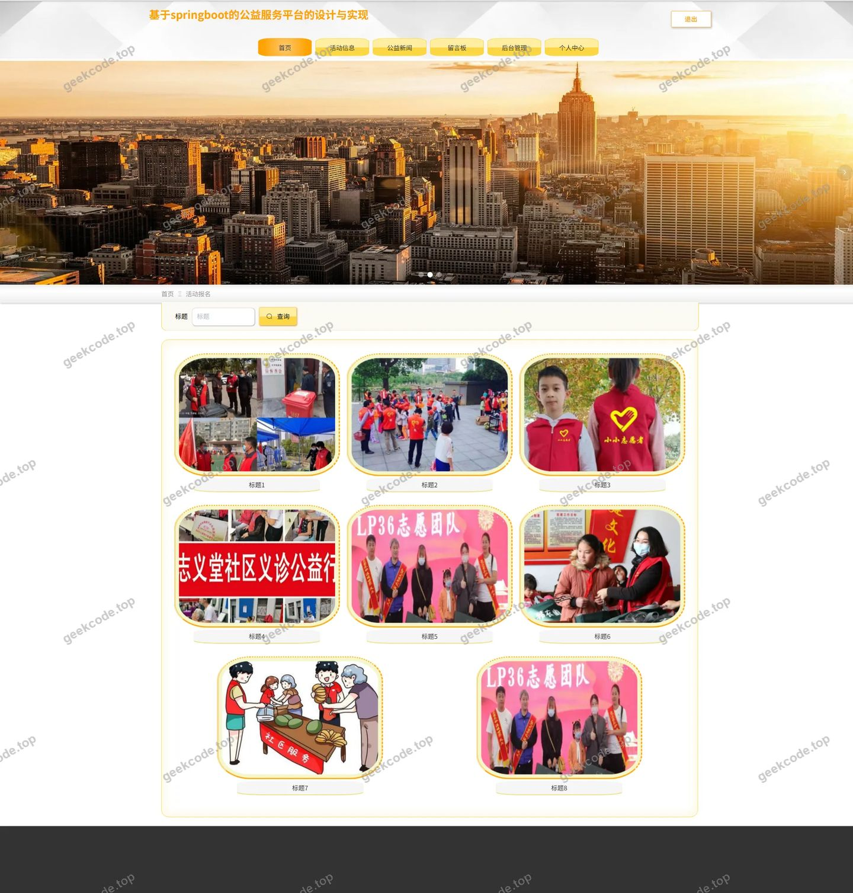</a>

<h4>前台-活动信息列表</h4>

<a href="https://geekcode.top/archives/%E5%9F%BA%E4%BA%8Espringboot%E7%9A%84%E5%85%AC%E7%9B%8A%E6%9C%8D%E5%8A%A1%E5%B9%B3%E5%8F%B0%E7%9A%84%E8%AE%BE%E8%AE%A1%E4%B8%8E%E5%AE%9E%E7%8E%B0?utm_source=github" title="查看完整源码">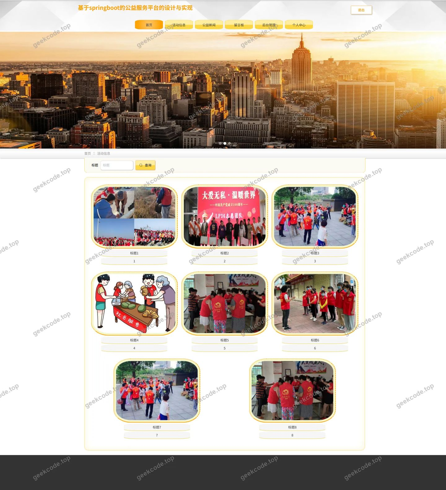</a>

<h4>前台-留言板列表</h4>

<a href="https://geekcode.top/archives/%E5%9F%BA%E4%BA%8Espringboot%E7%9A%84%E5%85%AC%E7%9B%8A%E6%9C%8D%E5%8A%A1%E5%B9%B3%E5%8F%B0%E7%9A%84%E8%AE%BE%E8%AE%A1%E4%B8%8E%E5%AE%9E%E7%8E%B0?utm_source=github" title="查看完整源码">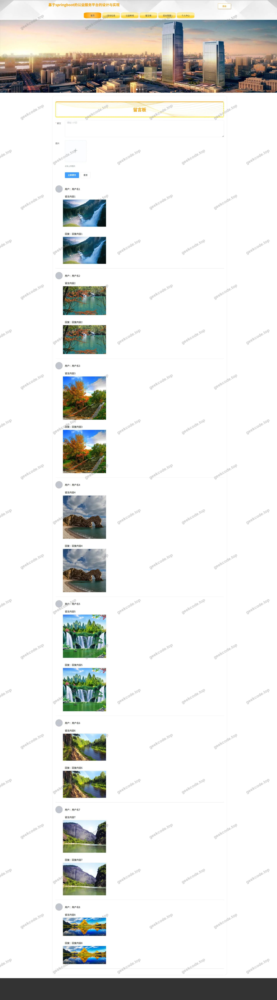</a>

<h4>前台-取消报名列表</h4>

<a href="https://geekcode.top/archives/%E5%9F%BA%E4%BA%8Espringboot%E7%9A%84%E5%85%AC%E7%9B%8A%E6%9C%8D%E5%8A%A1%E5%B9%B3%E5%8F%B0%E7%9A%84%E8%AE%BE%E8%AE%A1%E4%B8%8E%E5%AE%9E%E7%8E%B0?utm_source=github" title="查看完整源码">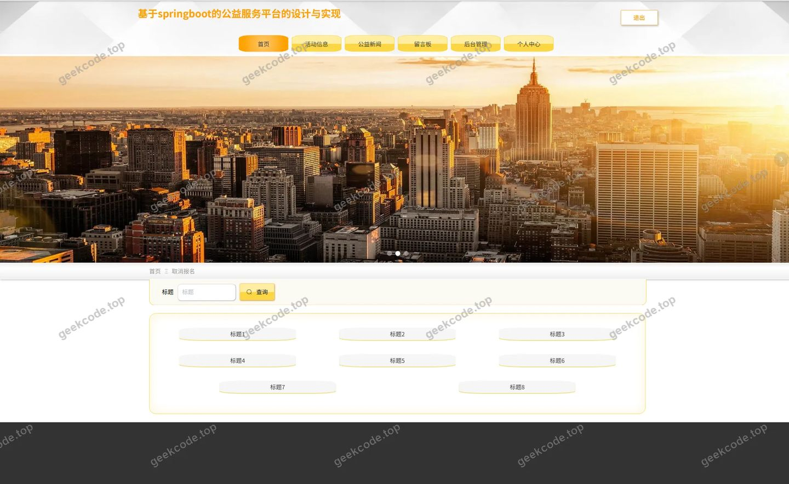</a>

<h4>前台-申请志愿者列表</h4>

<a href="https://geekcode.top/archives/%E5%9F%BA%E4%BA%8Espringboot%E7%9A%84%E5%85%AC%E7%9B%8A%E6%9C%8D%E5%8A%A1%E5%B9%B3%E5%8F%B0%E7%9A%84%E8%AE%BE%E8%AE%A1%E4%B8%8E%E5%AE%9E%E7%8E%B0?utm_source=github" title="查看完整源码">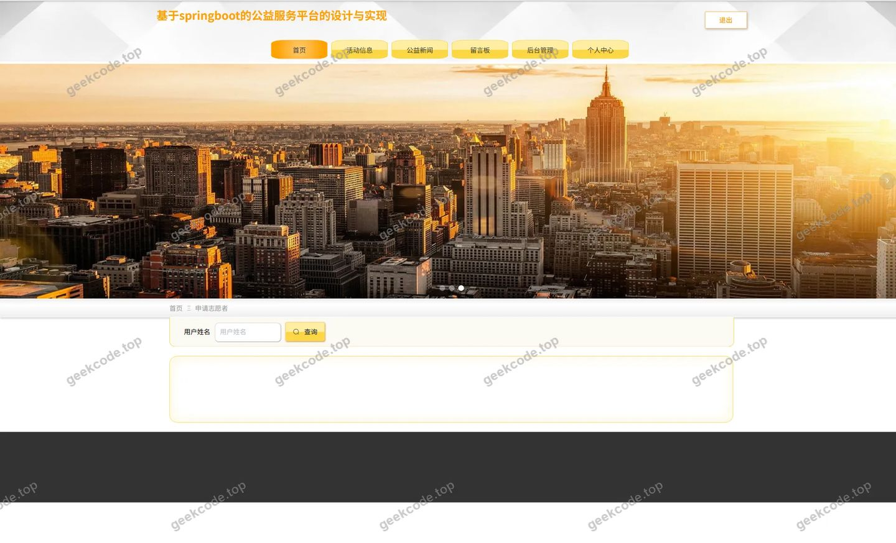</a>

<h4>前台-收藏列表</h4>

<a href="https://geekcode.top/archives/%E5%9F%BA%E4%BA%8Espringboot%E7%9A%84%E5%85%AC%E7%9B%8A%E6%9C%8D%E5%8A%A1%E5%B9%B3%E5%8F%B0%E7%9A%84%E8%AE%BE%E8%AE%A1%E4%B8%8E%E5%AE%9E%E7%8E%B0?utm_source=github" title="查看完整源码">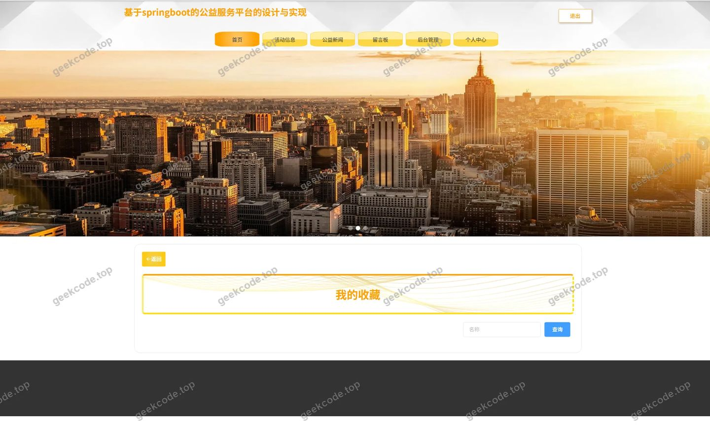</a>

<h4>前台-志愿者列表</h4>

<a href="https://geekcode.top/archives/%E5%9F%BA%E4%BA%8Espringboot%E7%9A%84%E5%85%AC%E7%9B%8A%E6%9C%8D%E5%8A%A1%E5%B9%B3%E5%8F%B0%E7%9A%84%E8%AE%BE%E8%AE%A1%E4%B8%8E%E5%AE%9E%E7%8E%B0?utm_source=github" title="查看完整源码">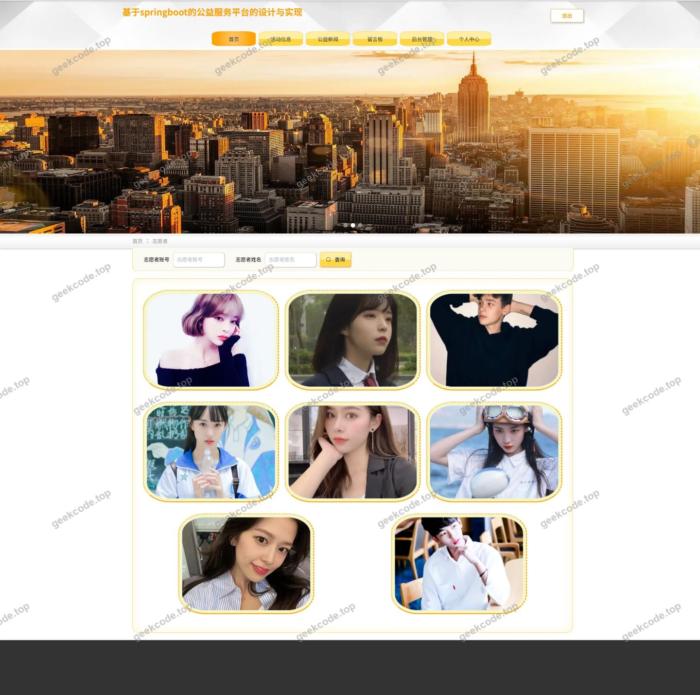</a>

<h4>前台-个人中心</h4>

<a href="https://geekcode.top/archives/%E5%9F%BA%E4%BA%8Espringboot%E7%9A%84%E5%85%AC%E7%9B%8A%E6%9C%8D%E5%8A%A1%E5%B9%B3%E5%8F%B0%E7%9A%84%E8%AE%BE%E8%AE%A1%E4%B8%8E%E5%AE%9E%E7%8E%B0?utm_source=github" title="查看完整源码">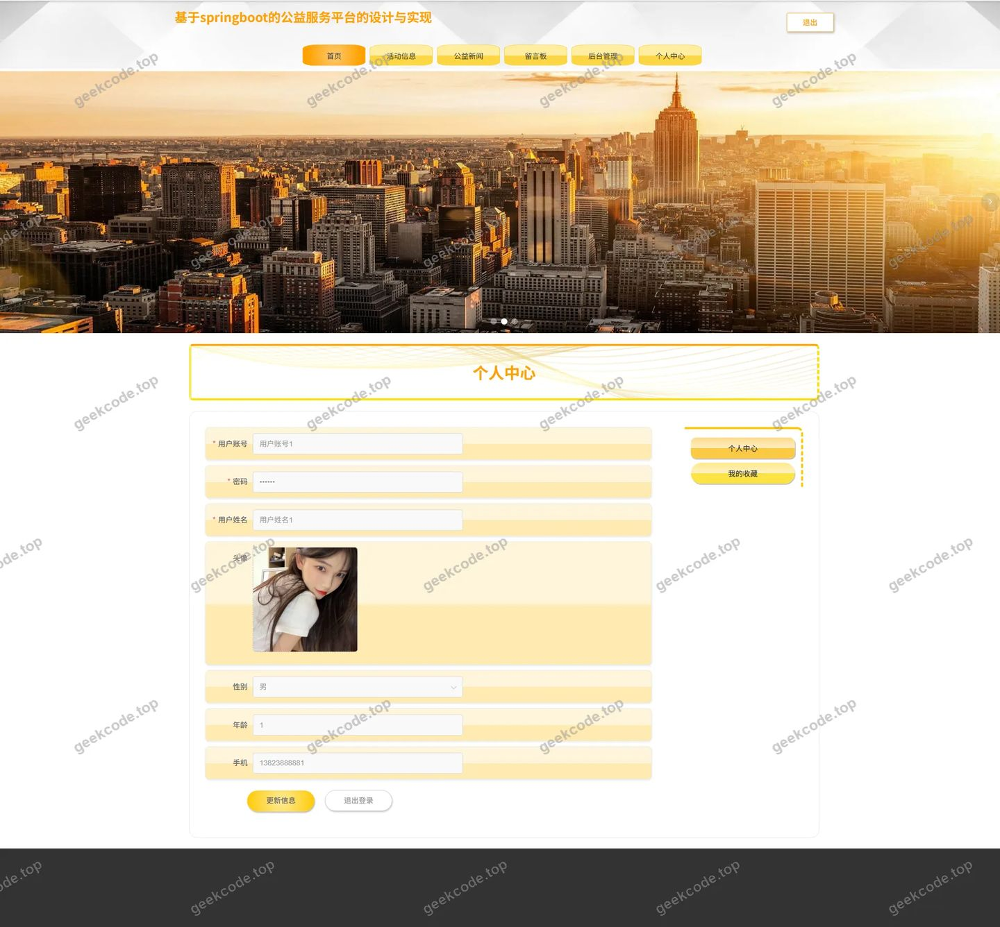</a>

<h4>前台-公告列表</h4>

<a href="https://geekcode.top/archives/%E5%9F%BA%E4%BA%8Espringboot%E7%9A%84%E5%85%AC%E7%9B%8A%E6%9C%8D%E5%8A%A1%E5%B9%B3%E5%8F%B0%E7%9A%84%E8%AE%BE%E8%AE%A1%E4%B8%8E%E5%AE%9E%E7%8E%B0?utm_source=github" title="查看完整源码">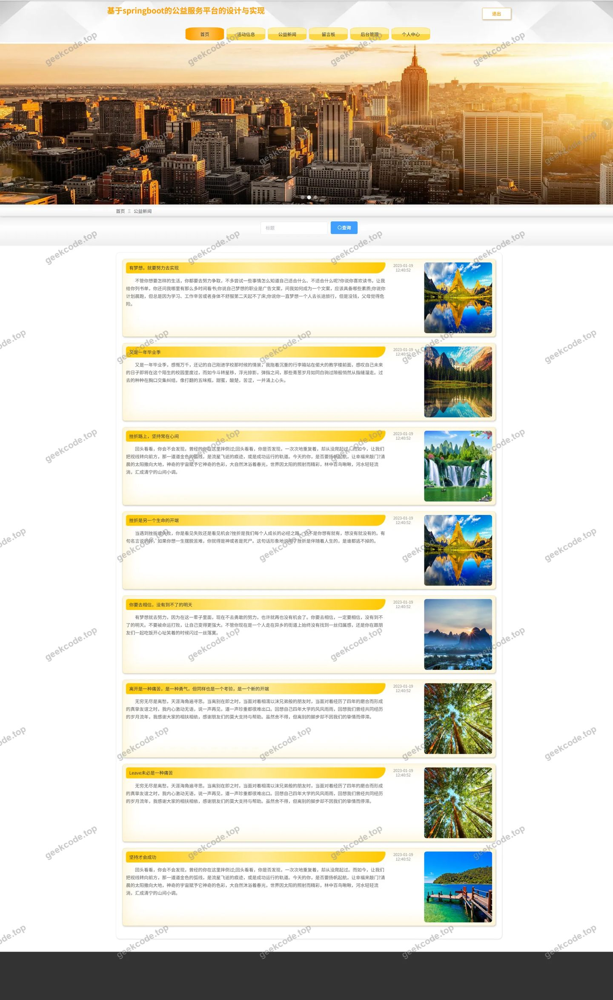</a>

<h3>后台管理端</h3>
<h4>后台-关于我们</h4>

<a href="https://geekcode.top/archives/%E5%9F%BA%E4%BA%8Espringboot%E7%9A%84%E5%85%AC%E7%9B%8A%E6%9C%8D%E5%8A%A1%E5%B9%B3%E5%8F%B0%E7%9A%84%E8%AE%BE%E8%AE%A1%E4%B8%8E%E5%AE%9E%E7%8E%B0?utm_source=github" title="查看完整源码">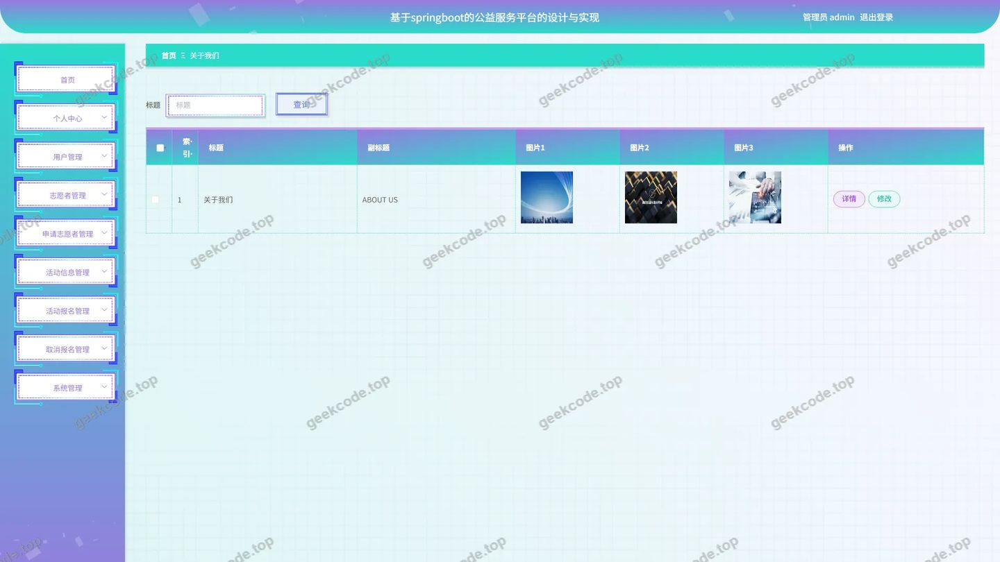</a>

<h4>后台-系统配置</h4>

<a href="https://geekcode.top/archives/%E5%9F%BA%E4%BA%8Espringboot%E7%9A%84%E5%85%AC%E7%9B%8A%E6%9C%8D%E5%8A%A1%E5%B9%B3%E5%8F%B0%E7%9A%84%E8%AE%BE%E8%AE%A1%E4%B8%8E%E5%AE%9E%E7%8E%B0?utm_source=github" title="查看完整源码">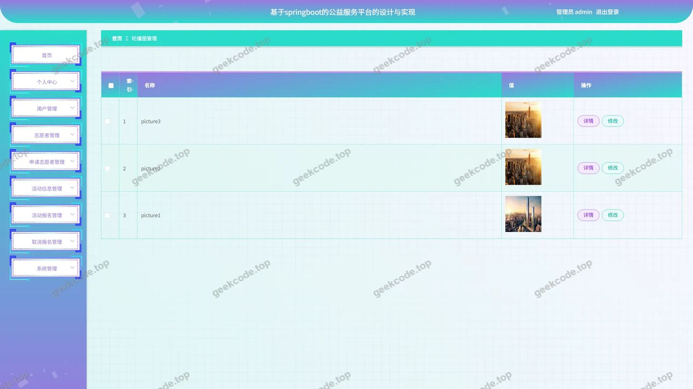</a>

<h4>后台-活动信息评论</h4>

<a href="https://geekcode.top/archives/%E5%9F%BA%E4%BA%8Espringboot%E7%9A%84%E5%85%AC%E7%9B%8A%E6%9C%8D%E5%8A%A1%E5%B9%B3%E5%8F%B0%E7%9A%84%E8%AE%BE%E8%AE%A1%E4%B8%8E%E5%AE%9E%E7%8E%B0?utm_source=github" title="查看完整源码">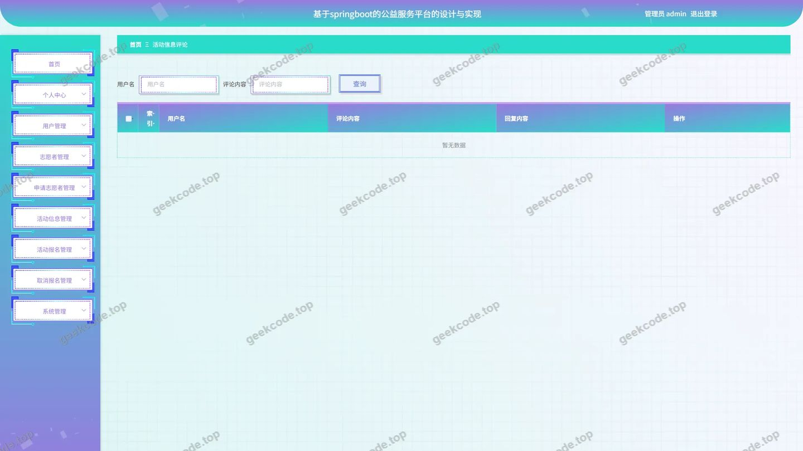</a>

<h4>后台首页</h4>

<a href="https://geekcode.top/archives/%E5%9F%BA%E4%BA%8Espringboot%E7%9A%84%E5%85%AC%E7%9B%8A%E6%9C%8D%E5%8A%A1%E5%B9%B3%E5%8F%B0%E7%9A%84%E8%AE%BE%E8%AE%A1%E4%B8%8E%E5%AE%9E%E7%8E%B0?utm_source=github" title="查看完整源码">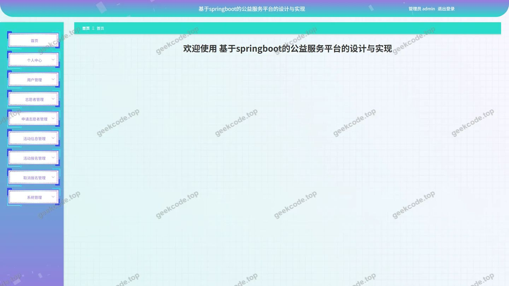</a>

<h4>后台-活动报名</h4>

<a href="https://geekcode.top/archives/%E5%9F%BA%E4%BA%8Espringboot%E7%9A%84%E5%85%AC%E7%9B%8A%E6%9C%8D%E5%8A%A1%E5%B9%B3%E5%8F%B0%E7%9A%84%E8%AE%BE%E8%AE%A1%E4%B8%8E%E5%AE%9E%E7%8E%B0?utm_source=github" title="查看完整源码">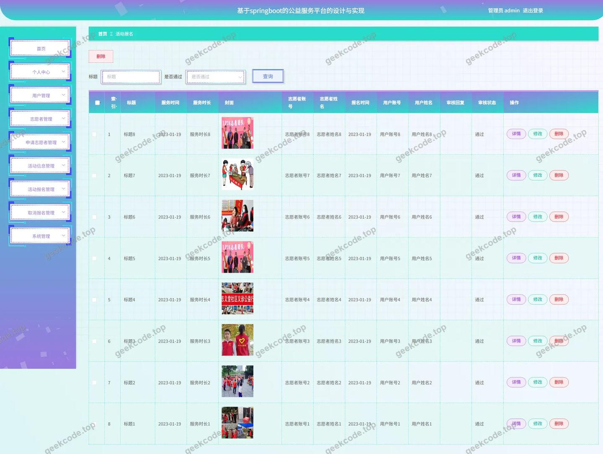</a>

<h4>后台-活动信息</h4>

<a href="https://geekcode.top/archives/%E5%9F%BA%E4%BA%8Espringboot%E7%9A%84%E5%85%AC%E7%9B%8A%E6%9C%8D%E5%8A%A1%E5%B9%B3%E5%8F%B0%E7%9A%84%E8%AE%BE%E8%AE%A1%E4%B8%8E%E5%AE%9E%E7%8E%B0?utm_source=github" title="查看完整源码">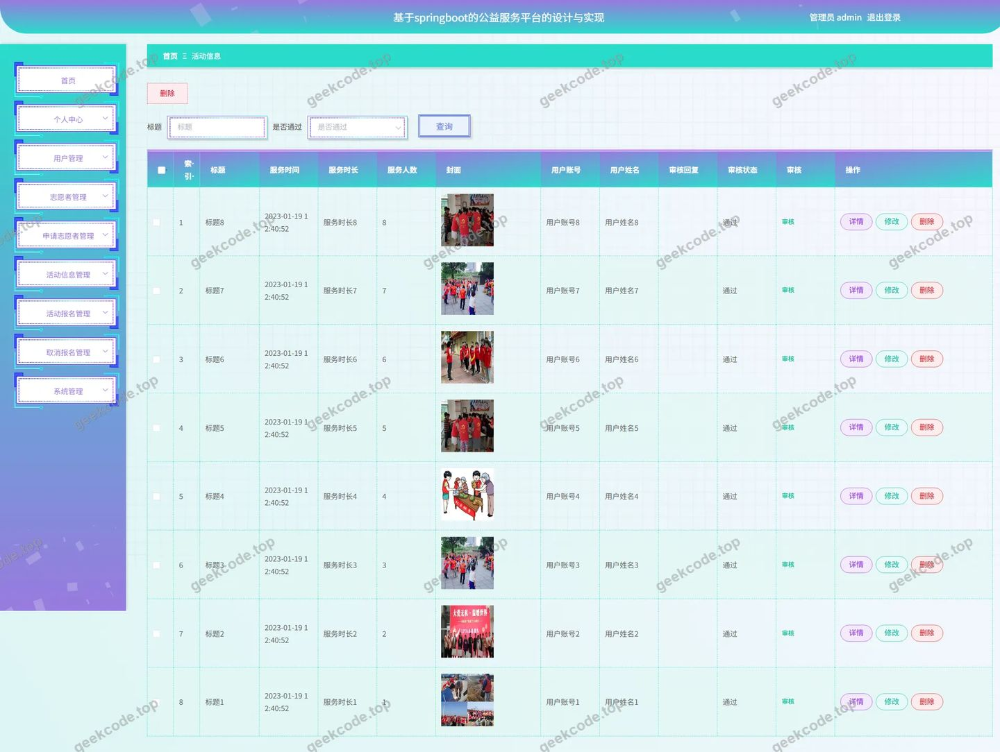</a>

<h4>后台-登录</h4>

<a href="https://geekcode.top/archives/%E5%9F%BA%E4%BA%8Espringboot%E7%9A%84%E5%85%AC%E7%9B%8A%E6%9C%8D%E5%8A%A1%E5%B9%B3%E5%8F%B0%E7%9A%84%E8%AE%BE%E8%AE%A1%E4%B8%8E%E5%AE%9E%E7%8E%B0?utm_source=github" title="查看完整源码">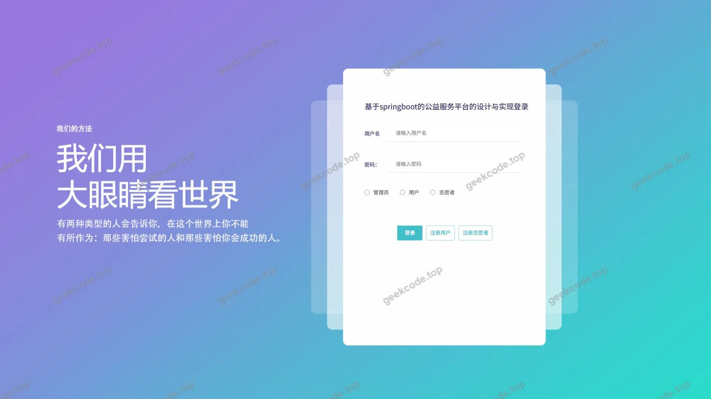</a>

<h4>后台-公告信息</h4>

<a href="https://geekcode.top/archives/%E5%9F%BA%E4%BA%8Espringboot%E7%9A%84%E5%85%AC%E7%9B%8A%E6%9C%8D%E5%8A%A1%E5%B9%B3%E5%8F%B0%E7%9A%84%E8%AE%BE%E8%AE%A1%E4%B8%8E%E5%AE%9E%E7%8E%B0?utm_source=github" title="查看完整源码">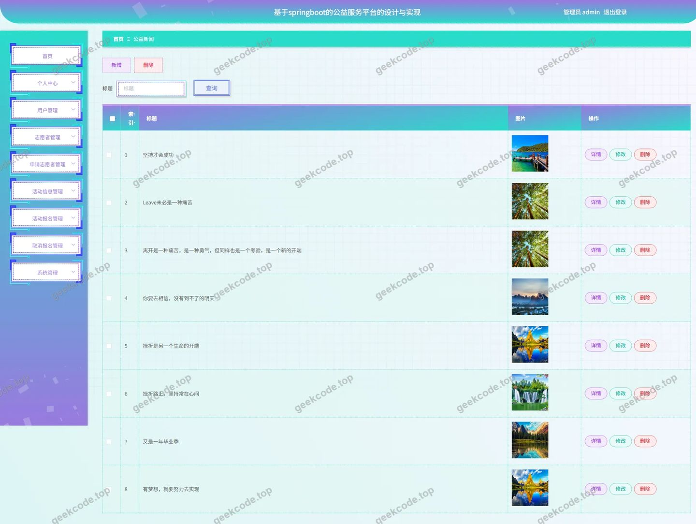</a>

<h4>后台-取消报名</h4>

<a href="https://geekcode.top/archives/%E5%9F%BA%E4%BA%8Espringboot%E7%9A%84%E5%85%AC%E7%9B%8A%E6%9C%8D%E5%8A%A1%E5%B9%B3%E5%8F%B0%E7%9A%84%E8%AE%BE%E8%AE%A1%E4%B8%8E%E5%AE%9E%E7%8E%B0?utm_source=github" title="查看完整源码">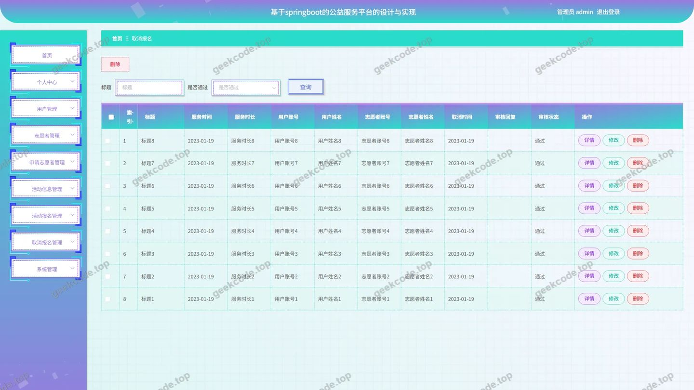</a>

<h4>后台-申请志愿者</h4>

<a href="https://geekcode.top/archives/%E5%9F%BA%E4%BA%8Espringboot%E7%9A%84%E5%85%AC%E7%9B%8A%E6%9C%8D%E5%8A%A1%E5%B9%B3%E5%8F%B0%E7%9A%84%E8%AE%BE%E8%AE%A1%E4%B8%8E%E5%AE%9E%E7%8E%B0?utm_source=github" title="查看完整源码">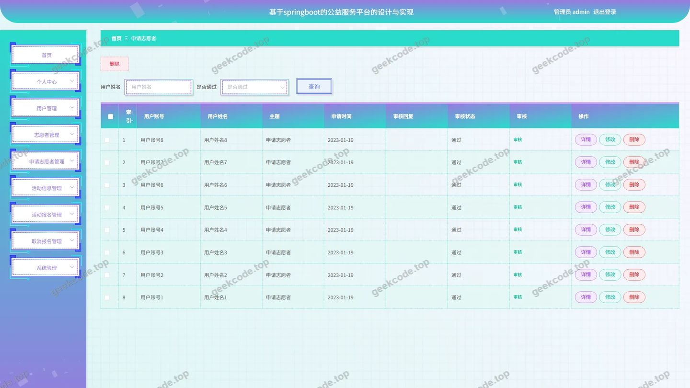</a>

<h4>后台-志愿者</h4>

<a href="https://geekcode.top/archives/%E5%9F%BA%E4%BA%8Espringboot%E7%9A%84%E5%85%AC%E7%9B%8A%E6%9C%8D%E5%8A%A1%E5%B9%B3%E5%8F%B0%E7%9A%84%E8%AE%BE%E8%AE%A1%E4%B8%8E%E5%AE%9E%E7%8E%B0?utm_source=github" title="查看完整源码">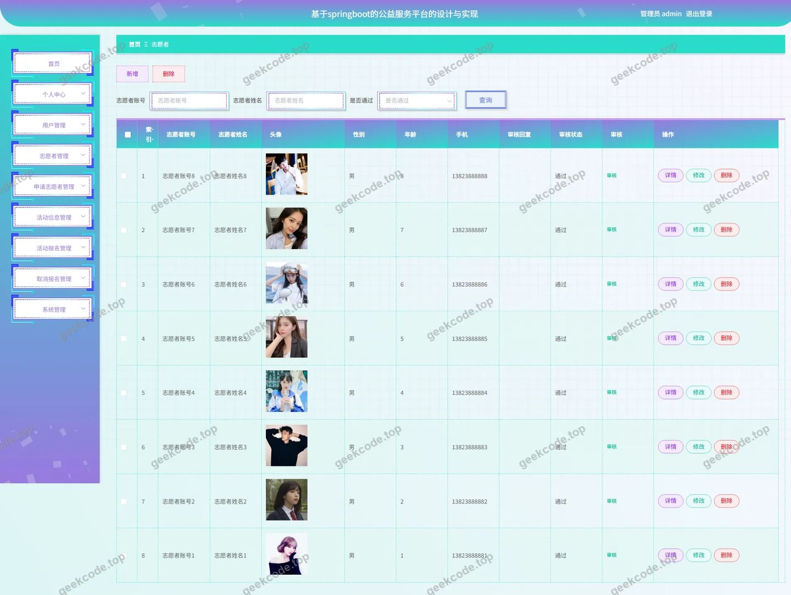</a>

---

## 获取完整源码

| 项目 | 说明 |
| --- | --- |
| 项目名 | 基于springboot的公益服务平台的设计与实现 |
| 运行截图 | 本文 21 张（站点带水印原图，仓库 `images/` 目录） |
| 完整源码 | [https://geekcode.top/archives/%E5%9F%BA%E4%BA%8Espringboot%E7%9A%84%E5%85%AC%E7%9B%8A%E6%9C%8D%E5%8A%A1%E5%B9%B3%E5%8F%B0%E7%9A%84%E8%AE%BE%E8%AE%A1%E4%B8%8E%E5%AE%9E%E7%8E%B0?utm_source=github](https://geekcode.top/archives/%E5%9F%BA%E4%BA%8Espringboot%E7%9A%84%E5%85%AC%E7%9B%8A%E6%9C%8D%E5%8A%A1%E5%B9%B3%E5%8F%B0%E7%9A%84%E8%AE%BE%E8%AE%A1%E4%B8%8E%E5%AE%9E%E7%8E%B0?utm_source=github) |
| 咨询微信 | **ir9372**（备注：jingpin-yuanma） |
| 更多项目 | [极客代码 geekcode.top](https://geekcode.top/?utm_source=github) |

> 需要源码、部署、改配置、跑不起来等问题，加微信 ir9372 沟通，说明项目名即可。
